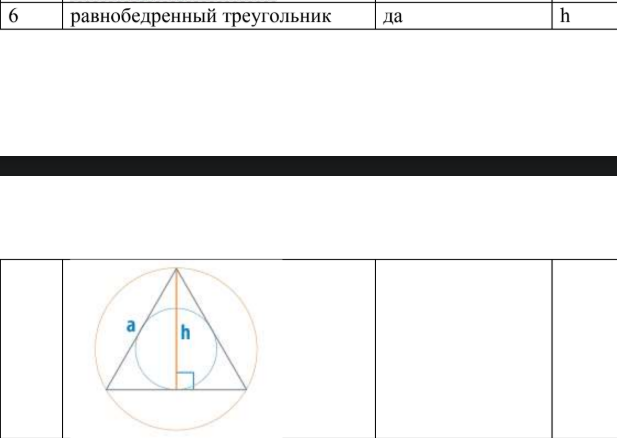
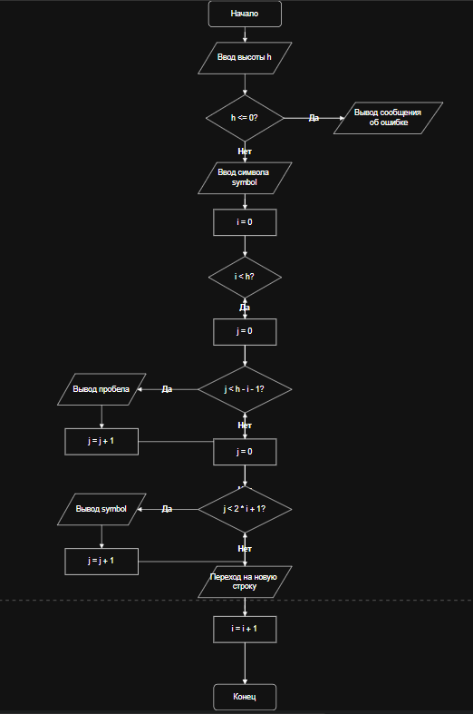

# Домашняя работа 9       
# Варинат 6
### Условие: 





# Код
```c
#define _CRT_SECURE_NO_WARNINGS
#include <stdio.h>
#include <locale.h>
#include <math.h>

int main() {
    setlocale(LC_ALL, "RUS");
    homework();
    return 0;
}
int homework() {
    int h;
    char symbol;

    printf("Равнобедренный треугольник\n");

    printf("Введите высоту треугольника h:\n");
    scanf("%d", &h);

    if (h <= 0) {
        printf("Ошибка! Высота должна быть больше 0.\n");
        return;
    }
    printf("Введите символ заполнения:\n");
    scanf(" %c", &symbol);

    for (int i = 0; i < h; i++) {

        for (int j = 0; j < h - i - 1; j++) {
            printf(" ");
        }
        for (int j = 0; j < 2 * i + 1; j++) {
            printf("%c", symbol);
        }
        printf("\n");
    }
}
```
